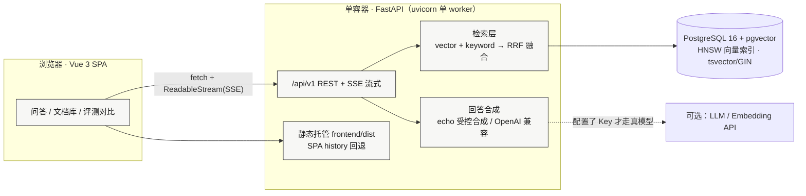
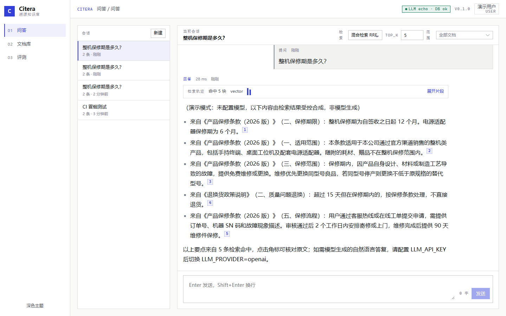
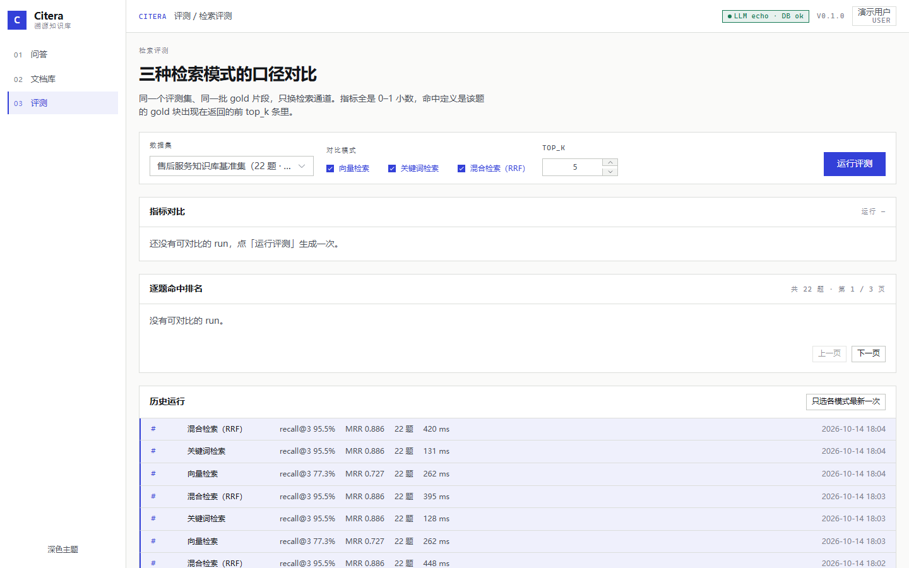
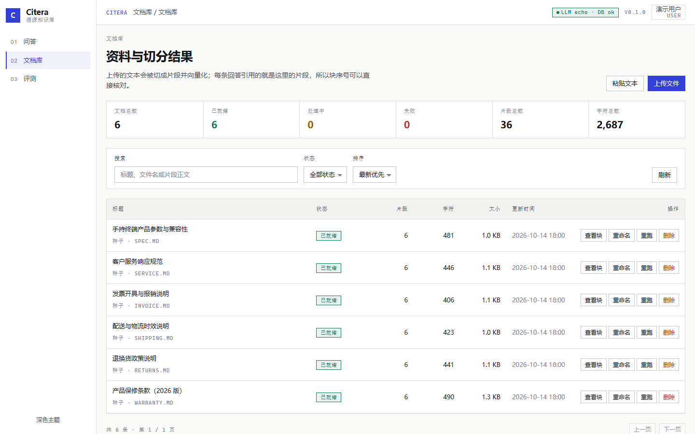
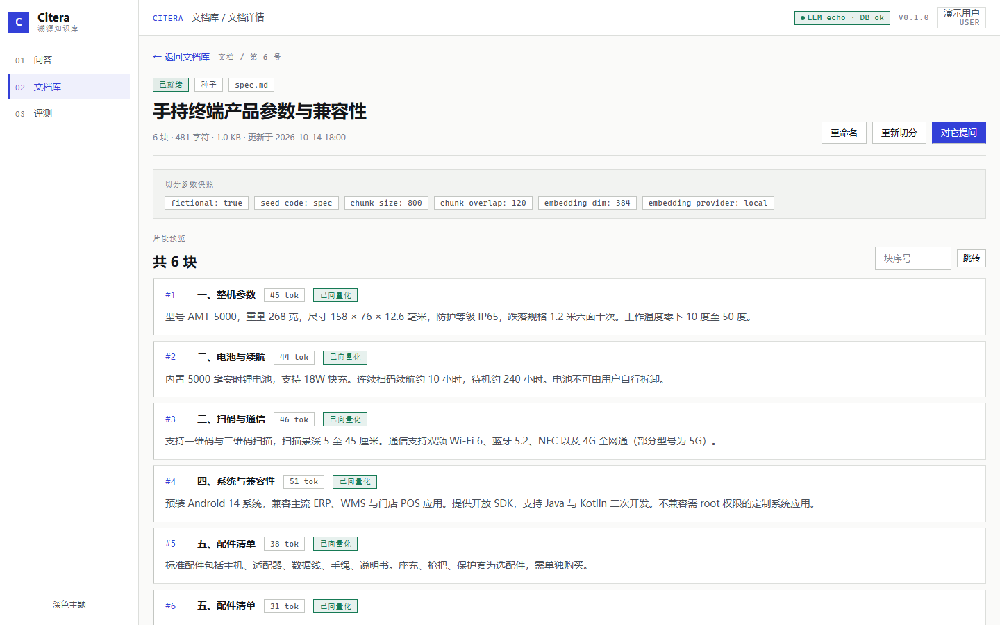

# Citera · 溯源知识库

**一句话定位**：把散落在 PDF / Markdown / 平台规则里的一堆资料，做成一个**每条回答都能点回原文**的知识库问答系统。

> 做 AI 应用最怕"答了没法核实"。所以这个项目把 **引用可溯源** 当第一目标，而不是把"回答像不像人话"当第一目标。

<!-- DEMO_URL -->
**在线 Demo**：⏳ *部署完成后填这里（部署步骤见 [docs/DEPLOY.md](docs/DEPLOY.md)）*
**演示账号**：`demo@citera.dev` / `demo1234`　·　**管理员**：`admin@citera.dev` / `admin1234`
<!-- /DEMO_URL -->

---

## 30 秒看懂



**一个容器、一个端口**：FastAPI 同时托管 `/api` 与前端 SPA，
部署时只需要「1 个 Web 服务 + 1 个 PostgreSQL」，不占两个免费服务额度。

---

## 它到底做了什么

1. **上传或粘贴资料** → 自动切分（先按 Markdown 标题/空行切语义段，超长再按句子边界递归切，不在句中硬切）→ 向量化。
2. **提问** → 向量召回 + 关键词召回**双路并跑**取并集候选池 → **名次级融合重排**（`Σ w/(60+rank)`，权重在评测集上实测选定），取 top-k。
   关键词路用 **IDF 加权覆盖率**打分（BM25 的 IDF 思路）——PostgreSQL 的 `ts_rank_cd` 对中文没有分词器、中文查询全部 0 分，实测后放弃。
3. **回答** → 每一句都挂 `[[cN]]` 角标，点开就是这个片段所在的**文档标题 / 章节 / 原文片段 / 相似度**，可直接跳回原文。
4. **评测页** → 内置 **22 题**评测集（14 条原文措辞 + **8 条同义改写**，每题标注 gold chunk），一键跑 `vector` / `keyword` / `hybrid` 三种模式，
   输出 Recall@1/3/5/10、MRR、Hit Rate、平均延迟，用柱状图 + 逐题排名表把**检索质量的差异量化出来**
   （实测数字见下方「评测数字」，三种模式跑的是同一批标注、同一个 top_k）。

**没配 LLM Key、甚至没有外网也能完整演示**：默认 `LLM_PROVIDER=echo` 时，
回答由检索结果**受控合成**（选出与问题词重合度最高的句子、按块顺序组织、逐句标注来源），
并在开头明确写出"演示模式：未配置模型，以下内容由检索结果受控合成，非模型生成"。
**绝不伪造模型回答。**

---

## 截图

| 问答 + 引用角标 | 评测页（三种模式历史运行指标） |
|---|---|
|  |  |

| 文档库 | 文档详情（切块预览） |
|---|---|
|  |  |

> 截图取自本地 `docker compose` 起的真实环境（1440×900），非设计稿。
> 复现脚本：`deploy/scripts/screenshot.mjs`。

---

## 评测数字

固定评测集 **22 题**（覆盖保修 / 退换货 / 物流 / 发票 / 客服规范 / 产品参数六个主题，
其中含 **8 条改写问句**——故意用不同说法问同一件事，用来暴露"只会字面匹配"的通道）、
每题标注 gold chunk、`top_k=5`、RRF `k=60`，同一批文档、同一套切分参数。
**数字由 `POST /api/v1/evaluations/run` 在真实容器（`docker compose` 单容器）里实跑得出，不是手填的。**

<!-- EVAL_NUMBERS -->
| 检索模式 | Recall@1 | Recall@3 | Recall@5 | Recall@10 | MRR | Hit Rate | 平均延迟 |
|---|---|---|---|---|---|---|---|
| `vector`（纯向量） | 63.6% | 77.3% | 86.4% | 86.4% | 0.727 | 86.4% | 10.6 ms |
| `keyword`（纯关键词） | 81.8% | 95.5% | 95.5% | 95.5% | 0.886 | 95.5% | 6.5 ms |
| **`hybrid`（RRF 融合）** | 81.8% | 95.5% | 95.5% | 95.5% | 0.886 | 95.5% | 18.5 ms |
<!-- /EVAL_NUMBERS -->

**怎么读这张表（也是我在面试里会主动讲的）**

- **纯向量最弱**：R@1 63.6%、Hit Rate 86.4%，比关键词路低约 18 个百分点。
  根因是那 8 条改写问句——**默认向量不是语义模型**（见下方「已知局限」），只靠字面 n-gram 相似度，换种说法就掉。
- **`hybrid` 与 `keyword` 在这份标注上并列第一**（R@1 81.8%、R@3 95.5%、MRR 0.886）。
  hybrid 的价值不在"分数更高"，而在**更稳**：任何一路失效时另一路能托住——
  实测把提问限定到某篇文档、关键词路零命中时，早期 RRF 版本会直接答"没有检索到"，现在是向量候选兜底并给出引用。
- **代价是延迟**：hybrid 18.5 ms ≈ 两路之和（10.6 + 6.5）。交互式问答可接受。
- **我没有为了让某个通道"最好看"去调评测集或调参。** 三种模式跑的是同一批 gold 标注、同一个 top_k；
  这组数字里 hybrid 并没独占鳌头，我照实写。**真实工程里更该关心的不是"谁第一"，而是"换个问法会不会崩"**——
  这正是这份含改写问句的评测集要回答的问题。

**已知局限（我会主动说，不等面试官问）**

- 默认 `EMBEDDING_PROVIDER=local` 是**确定性哈希向量**，不是语义模型。它保证离线可跑、结果可复现，
  但**不具备跨语义改写的检索能力**：改写子集上 vector 只命中 5/8，而 keyword 7/8。
  配真实 embedding（`EMBEDDING_PROVIDER=openai`）后应当重跑这份评测，**在那之前我不声称 hybrid 优于关键词**。
- 正因如此，我把 hybrid 的向量权重压低到 0.25——这是**实测扫描出的最优区间**，而不是理论值。
  权重给满（1.0）时弱向量命中会挤掉关键词的准确命中，R@1 反而掉到 0.75 左右。

*复现：`docker compose -f deploy/docker-compose.yml up -d --build` 后
`python deploy/scripts/smoke_api.py` 验证链路；前端与图表另跑浏览器端到端
（`tools/e2e_final.py`，13 项断言）。完整实测证据见 `docs/E2E-REPORT.md` 与 `docs/PROGRESS.md`。*

---

## 本地启动（三步）

> 前置：装好 **Docker Desktop**（Windows/macOS）或 Docker Engine（Linux）。
> 不需要本地装 Python / Node / PostgreSQL —— 依赖全在镜像里。

```bash
# 1) 拉代码
git clone <你的仓库地址> citera-kb && cd citera-kb

# 2) 一条命令构建并启动（首次约 3–8 分钟）
docker compose -f deploy/docker-compose.yml up -d --build

# 3) 打开 http://localhost:8000，用 demo@citera.dev / demo1234 登录
```

首次启动会自动建扩展、建表并**灌入演示数据**（6 篇虚构演示文档 + 22 题评测集 + 2 个演示账号），
打开就能直接提问，不需要先上传文件。种子灌入是**幂等**的：重复启动不会重复建文档、也不会重建向量。

**不想敲命令**：双击 `deploy/scripts/start-local.cmd`（Windows）或
`bash deploy/scripts/start-local.sh`（Linux/macOS/WSL）——它会检查 Docker、
启动服务、等健康检查通过、自动打开浏览器。

**验证环境是否就绪**（部署前自检）：

```bash
python deploy/scripts/preflight.py --mode local    # 检查环境变量/端口/数据库/pgvector
python deploy/scripts/smoke_api.py                 # 端到端：登录→建会话→提问→校验引用
```

---

## 技术栈

| 层 | 选型 |
|---|---|
| 后端 | Python 3.12 · FastAPI 0.143 · SQLAlchemy 2.1（`Mapped[]` 风格）· Alembic（空库一次迁移到位）· Pydantic v2 |
| 数据库 | PostgreSQL 16 + **pgvector**（`vector(384)` + HNSW 余弦索引）· `jsonb` · `bigint[]` · `tsvector`/GIN（预留中文分词切换点） |
| 检索 | 向量召回 + IDF 加权关键词召回 **双路并集 → 名次级融合重排**（`Σ w/(60+rank)`，权重实测选定） |
| 前端 | Vue 3.5（`<script setup>` + TS）· Vite 8 · Pinia · Vue Router · Element Plus（仅交互件，视觉自定义）· ECharts（按需引入）· DOMPurify |
| 鉴权 | JWT（HS256，access 12h）+ **标准库 `hashlib.scrypt`** 密码哈希（不引第三方哈希库） |
| 流式 | Server-Sent Events（`fetch` + `ReadableStream`，因为要带 Authorization 头） |
| 测试 | 后端 **124 项 pytest**（含 PostgreSQL+pgvector 集成测试）· 前端 **91 项 vitest** · 浏览器端到端 13 项断言 |
| 交付 | 多阶段 Dockerfile（单容器单端口）· docker compose · GitHub Actions CI（pytest + build + vitest + 容器端到端冒烟） |

---

## 项目结构

```
citera-kb/
├── backend/          # FastAPI：api / services / models / schemas / core / db + alembic + tests
├── frontend/         # Vue 3 SPA：views / stores / api / styles（设计令牌集中管理）
├── deploy/           # Dockerfile（多阶段）· compose（本地 + 生产）· 一键脚本 · 部署自检
├── .github/workflows/ci.yml
└── docs/             # CONTRACT.md（唯一事实来源）· DEPLOY.md · PROGRESS.md
```

---

## API 文档

跑起来后（本地或公网域名）：

- **Swagger UI**：`/api/docs`
- **ReDoc**：`/api/redoc`
- **OpenAPI JSON**：`/api/openapi.json`
- **健康检查**：`/api/health`
- **元信息（含配额）**：`/api/v1/meta`

接口契约（含错误码、SSE 事件顺序、分页规范）见 [`docs/CONTRACT.md`](docs/CONTRACT.md) —— 它是本项目的**唯一事实来源**，前后端都按它实现。
契约的每次变更都记录在 [`docs/CHANGELOG-contract.md`](docs/CHANGELOG-contract.md)（含"某个方案被评测否决"的过程，例如 C-008）。

---

## 部署

免费容器平台的点选清单、环境变量取值、平台不可用时的降级路径（自有 ECS + 域名 + Caddy 自动 HTTPS）：
👉 **[docs/DEPLOY.md](docs/DEPLOY.md)**

上线前先跑一次自检：

```bash
python deploy/scripts/preflight.py --mode prod --env-file deploy/.env
```

---

## 二次开发

- **想接真实模型**：设 `LLM_PROVIDER=openai` + `LLM_BASE_URL` / `LLM_API_KEY` / `LLM_MODEL`
  （任何 OpenAI 兼容接口都行），回答立刻切换为真流式；`citations` 结构和 SSE 事件序列**完全不变**，
  因为两条路径共用同一个接口（契约 §5.3）。
- **想换向量模型**：`EMBEDDING_PROVIDER=openai` + `EMBEDDING_DIM` 同步调整（迁移里维度写死为 384，改维度需重建列）。
- **想调检索参数**：`RETRIEVAL_MODE` / `TOP_K` / `RRF_K`，或直接在管理台改 `app_settings`。
- **想加文档解析格式**：`backend/app/services/ingest.py` 里加解码分支，扩展名白名单同步更新。

---

## 从 0 自研声明

**本项目从 0 自研，无上游 fork。**

没有基于任何开源 RAG 项目、脚手架模板或课程作业二次修改：
检索融合（RRF）、切分器、受控合成回答、评测口径、接口契约、数据库模型、前端引用交互、
多阶段镜像与 CI 流水线都是为本项目从零设计和实现的。
依赖均为公开的通用库（FastAPI / SQLAlchemy / Vue / Vite 等），符合各自开源许可。

---

## 面试自述（可直接讲，≤200 字）

> 我做的是 Citera 溯源知识库。市面上的 RAG Demo 大多在比"回答像不像人话"，
> 但我发现真正卡住落地的是**答了没法核实**，所以我把"引用可溯源"做成了第一目标：
> 每条回答都挂角标，点开能看到原文片段、章节和相似度，直接跳回文档。
> 技术上用向量 + 关键词双路召回、并集候选池做名次级融合重排，配了一套 **22 题**的评测集
> （含 8 条同义改写问句），能一键跑出三种检索模式的 Recall 和 MRR 对比。
> 另外我特意让它在**没有模型 Key、没有外网**时也能完整演示——这时候答案由检索结果受控合成并逐句标注来源，
> 而不是假装有模型。整个系统一个容器一个端口就能起，数据库用 pgvector，
> CI 里跑 124 项后端测试、91 项前端测试和容器端到端冒烟。

---

## 许可

仅用于作品集展示与面试评估。演示文档内容均为**虚构资料**（正文页脚已注明），不涉及任何真实企业数据。
